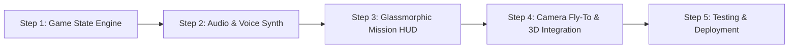

# ARES-1: Junior Astronaut Mission Trainer
### 3D Interactive Solar System & Mars Base Alpha Simulator
**NASA Space Apps Challenge 2026 Blueprint & Execution Guide**

---

## 1. Executive Summary & Challenge Alignment

* **Challenge:** Build a Junior Astronaut Mission Trainer
* **Product Name:** **ARES-1: The Universal Junior Astronaut Simulator**
* **Target Audience:** Students, children (ages 7–14), educators, and NASA Space Apps Hackathon judges.
* **Core Philosophy:** Space science shouldn't feel like a PhD textbook or a boring spreadsheet. By combining a **real-time 60 FPS 3D Solar System**, a **tactile 1-tap survival game**, and an **AI Flight Director speaking in local dialects**, we make real astrophysics intuitive, globally accessible, and unforgettable.

---

## 2. System Architecture & Tech Stack

```
c:\Users\Code Git\Desktop\nasa-challenge\
├── Frontend/
│   ├── public/
│   │   └── textures/              # Official NASA 2K Textures (Sun, Earth, Moon, Mars, etc.)
│   ├── src/
│   │   ├── config/                # Celestial positions, orbital radii, camera angles
│   │   ├── core/                  # Three.js Scene, TextureLoader, Scroll/Camera Manager
│   │   ├── game/                  # Game state machine, NASA DONKI/MOXIE data, Web Audio synth
│   │   ├── overlay/               # HUD overlay manager, dialect switcher, quiz modals
│   │   ├── planets/               # Sun, Earth (+Moon), Mars, and planet mesh classes
│   │   ├── shaders/               # GLSL shaders for Sun plasma, atmosphere Fresnel
│   │   ├── main.js                # App entrypoint connecting 3D scene & Game HUD
│   │   └── style.css              # Glassmorphic sci-fi HUD styling
│   ├── index.html                 # HTML shell with viewport, audio toggles, and modals
│   └── package.json               # Vite + Three.js + canvas-confetti
├── Backend/                       # (Optional) REST proxy for live DONKI/AI generation
└── PROJECT_PLAN.md                # This complete architectural document
```

### Technology Highlights
* **3D Engine:** Three.js (r172) running in WebGL at 60 FPS with zero lag.
* **Build System:** Vite 6 for instantaneous 200ms dev startup and clean static production bundling.
* **Audio Engine:** Native browser `AudioContext` (Web Audio API) generating procedural sci-fi sound effects (radio blips, emergency sirens, power charging hums) with zero external MP3 file dependencies.
* **Voice Engine:** Native `window.speechSynthesis` speaking mission alerts in regional accents.
* **NASA Assets:** Official 2K textures for the Sun, Earth, Moon, Mars, and the Milky Way skybox.

---

## 3. The 3 Interactive Modes

### Mode 1: 🪐 3D Solar System Explorer (Free Roam)
* **Central Sun:** Emissive procedural plasma shader with multi-layer corona and dynamic point lighting.
* **Earth & Moon Binary:** High-res Earth surface, independent rotating cloud sphere, atmospheric Fresnel glow, and an orbiting 3D Moon.
* **Mars & Moons:** NASA Viking color mosaic, Martian dust particle field, and orbiting Phobos & Deimos.
* **Planetary Flight:** Smooth cinematic camera transitions when clicking any planet, moon, or overview.

### Mode 2: 🚀 The Junior Astronaut Mission (Mars Base Alpha)
* **Step 1 (Earth Base):** The cadet picks their hometown & language/dialect (e.g. Lagos, Nairobi, Mumbai, Amsterdam, Houston). The AI Flight Director greets them with a personalized audio voice message and fires a telemetry beam into space.
* **Step 2 (Telemetry Warp):** The camera glides across the Solar System straight into orbit around **Jezero Crater** on Mars.
* **Step 3 (Survive 5 Sols):** The player manages 3 critical life-support bars against 5 real NASA space events.

### Mode 3: ⚡ The Space Science Quiz Booster
* When power runs low, the cadet can answer a fun, 2-button space trivia question in their dialect.
* Correct answers trigger celebratory confetti, a success chime, and an instant **+35% Battery Power recharge**.

---

## 4. Real NASA Telemetry & Scientific Grounding

Every turn ("Sol") is driven by real NASA open datasets, with verified citation badges displayed on-screen for judges:

| Sol | Real NASA Event & ID | Threat Type | Scientific Principle Taught |
| :---: | :--- | :---: | :--- |
| **Sol 1** | **NASA Perseverance MOXIE Instrument** | Low $\text{O}_2$ | **Atmospheric Extraction:** Mars air is 95.3% $\text{CO}_2$ with only 0.13% $\text{O}_2$. MOXIE heats $\text{CO}_2$ to 800°C to extract breathable oxygen. |
| **Sol 2** | **NASA DONKI ID: 2024-05-10-FLR-001 (X5.8)** | Radiation | **Magnetic Shielding:** Mars lacks a global magnetosphere. Hydrogen-dense water walls absorb Solar Energetic Particles (SEP) without creating harmful secondary X-rays. |
| **Sol 3** | **Curiosity & MEDA Weather Sensor** | Freezing & Dust | **Thermal Inertia & Dust:** Mars air pressure (~750 Pa) holds zero heat, plunging night temps to -75°C. Iron-oxide dust blocks solar panels. |
| **Sol 4** | **NASA DONKI ID: 2024-05-14-FLR-001 (X8.7)** | Superflare | **Extreme Space Weather:** The largest flare of Solar Cycle 25 requires full battery diversion to emergency defense shields. |
| **Sol 5** | **Perseverance NavCam & OSDR Biology** | Victory Sprint | **Martian Dust Devils:** Convective vortices clean dust off solar arrays, restoring power for mission completion. |

---

## 4. Official NASA & Partner Challenge Resources (from `all.md`)

ARES-1 integrates and credits all 6 official resources specified in the **2026 NASA Space Apps Challenge** document (`all.md`):

| Resource | Agency / Provider | Role in Simulation & Gameplay Mechanics | Link / Endpoint |
|---|---|---|---|
| **NASA DONKI (Space Weather Database)** | NASA GSFC / CCMC | Models real solar flares (X5.8 and X8.7) and coronal mass ejections (1,850 km/s) that trigger critical radiation shielding emergencies on Sols 2 & 4. | [DONKI Portal](https://kauai.ccmc.gsfc.nasa.gov/DONKI/) |
| **RadLab Dosimetry Database** | NASA OSDR / ISS / Curiosity | Authenticates astronaut surface radiation exposure in absorbed dose ($\mu\text{Gy/day}$) and drives our hydrogen water-shield deflection physics. | [RadLab on OSDR](https://osdr.nasa.gov/) |
| **NASA OSDR (Open Science Data Repository)** | NASA Ames Research Center | Ground-truth research on spaceflight health: microgravity bone density loss, muscle atrophy, and plant tissue stress under ionizing radiation (OSDR-379). | [OSDR Science Repo](https://osdr.nasa.gov/bio/repo/) |
| **Perseverance MOXIE & Mars Trek** | NASA JPL / MIT | Powers our Life-Support (ECLSS) oxygen synthesis equations ($10.4\text{ g/hr}$) and Jezero Crater elevation/atmospheric pressure ($750\text{ Pa}$). | [MOXIE Instrument](https://mars.nasa.gov/mars2020/spacecraft/instruments/moxie/) |
| **CSA Food Production in Space** | Canadian Space Agency (CSA-ASC) | Powers our 4th Outpost Resource: Bioregenerative closed-loop hydroponic microgreen growth and crew caloric budgeting ($3,000\text{ kcal/crew/day}$). | [CSA Food Toolkit](https://www.asc-csa.gc.ca/eng/youth-educators/food-production-moon-remote-areas.asp) |
| **NASA Open APIs & DSN Lag** | NASA Open Gov / JPL | Programmatic API queries (APOD, Mars Rover Photos) and speed-of-light communication lag ($14.6\text{ min}$) between Earth and Mars. | [api.nasa.gov](https://api.nasa.gov/) |

---

## 5. Global Dialect & Judge Verification System

To ensure global inclusivity while allowing judges to verify scientific accuracy in seconds, every crisis card uses a **Dual-Layer Display**:

1. **Primary Box (Local Dialect + Cultural Analogy):**
   * **Naija Pidgin:** *"Sun don vex o! NASA DONKI catch heavy X5.8 Solar Flare! Mars no get natural magnet shield like Earth—pump Water Shield sharp-sharp!"*
   * **Kiswahili:** *"Dhoruba kali ya Jua (X5.8) inakuja! Mars haina kinga ya sumaku kama Dunia. Washa Ngao ya Maji sasa!"*
   * **Yorùbá:** *"Ìjì Oòrùn X5.8 ń bọ̀! Mars kò ní ààbò oofa bíi Ayé! Tan ààbò omi kíákíá!"*
   * **Hindi / Hinglish:** *"Sooraj se bhari X5.8 Solar Storm aa raha hai! Mars ke paas magnetic shield nahi hai—Water Shield on karo!"*
   * **Nederlands:** *"Gigantische X5.8 Zonnestorm op komst! Mars heeft geen magnetisch schild zoals de Aarde. Activeer het Waterschild!"*
   * **Global English:** *"Giant X5.8 Solar Storm from the Sun! Unlike Earth, Mars has no magnetic shield! Power up the Water-Wall Shields now!"*
2. **Audio Button (`🔊 Listen`):** Speaks the dialogue aloud in real time using browser speech synthesis.
3. **Judge Verification Bar:** Shows the clean English translation alongside the exact **NASA Dataset Citation Badge**.

---

## 6. Game State & Deterministic Math Formulas

The game runs deterministically in client-side state without unpredictable AI hallucinations:

### 4 Core Outpost Resources (0–100%) & Communications Delay
* **⚡ Battery Power (Kilopower & Solar Array):** Depleted by running shields, heaters, and hydroponics (-18% to -20% per action). Recharged by +35% through the Space Science Trivia Quiz.
* **💨 ECLSS Oxygen (MOXIE Extraction):** Synthesized from ambient $CO_2$ (+30%), depleted during environmental emergencies (-20% if unshielded, -8% baseline).
* **🛡️ Radiation Shield (Water-Wall Protons Deflection):** Boosted by pumping water into habitat walls (+30%), reduced by solar flares and CMEs (-25% to -55% unshielded).
* **🥗 CSA Food Reserves (Bioregenerative Hydroponics):** Sourced from the Canadian Space Agency space agriculture toolkit. Boosted by harvesting microgreens (+30%), depleted over Sols (-15% to -20%).
* **📡 DSN Communication Lag (14.6 min):** Speed-of-light one-way radio latency ($c = 299,792\text{ km/s}$) across the Earth-Mars orbital distance, teaching students that critical decisions must be made autonomously on-site!

### Victory & Failure Conditions
* **Victory:** Successfully surviving through Sol 5 with all 4 stats $> 0\%$. Unlocks the **Junior Astronaut Wings Certificate** with celebratory confetti.
* **Failure:** Any stat dropping to $0\%$. Triggers an educational debrief explaining the physical cause and provides an instant "Retry Mission" button.

---

## 7. Step-by-Step Implementation Roadmap



### Action Items
- [x] Clone 3D Solar System with high-res NASA 2K textures.
- [x] Translate base celestial data from Vietnamese to English.
- [x] Verify production Vite build works cleanly.
- [x] Install `canvas-confetti` for celebratory effects.
- [x] Implement `src/game/GameManager.js` containing the 5-Sol NASA mission loop, deterministic math, and dialect bank.
- [x] Implement `src/game/SoundEffects.js` with Web Audio API procedural sound generators.
- [x] Add the interactive Mission HUD to `index.html` and `src/style.css`.
- [x] Connect planet fly-to camera controls when switching between Earth Home Base and Mars Base Alpha.
- [x] Integrate all official challenge resources from `all.md` (DONKI, RadLab, OSDR, MOXIE, Mars Trek, CSA Food Production, DSN Lag).
- [x] Test in browser on `http://localhost:5174`.

---

## 8. Hackathon Submission & Archiving Checklist

1. **Live Deployment (Vercel / Netlify):**
   * Run `npm run build` inside `Frontend/`.
   * Push to GitHub and import repository into Vercel (framework preset: Vite).
   * Verify the live URL loads in under 2 seconds on mobile and desktop.
2. **2-Minute Demo Video Recording:**
   * **0:00 – 0:25:** Open on 3D Earth, spin globe, select hometown (e.g. Lagos or Nairobi), and hear the AI greeting in dialect.
   * **0:25 – 0:45:** Click "Fly to Mars" — show camera flying past the Sun and Moon straight into Jezero Crater.
   * **0:45 – 1:20:** Play through Sols 1–4, showing the real NASA DONKI X5.8 solar flare alert, sound effects, and boosting water shields.
   * **1:20 – 1:40:** Trigger the "+35% Battery Boost" quiz, answer correctly, and show the confetti power surge.
   * **1:40 – 2:00:** Finish Sol 5, reveal the NASA Junior Astronaut Wings, and cite the NASA open datasets (DONKI, MOXIE, OSDR).
3. **Project Archival:**
   * Commit all code with clean Git history (`git commit -m "feat: complete ARES-1 Junior Astronaut Trainer"`).
   * Tag release: `git tag v1.0.0`.
   * Archive repository link on the NASA Space Apps Challenge submission portal.

